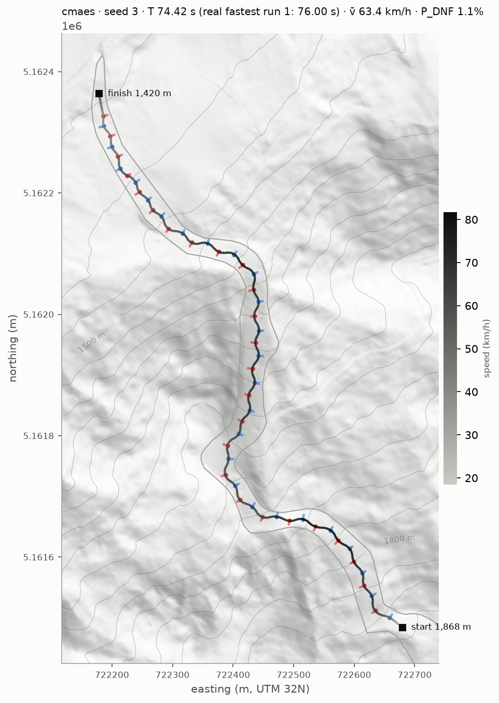
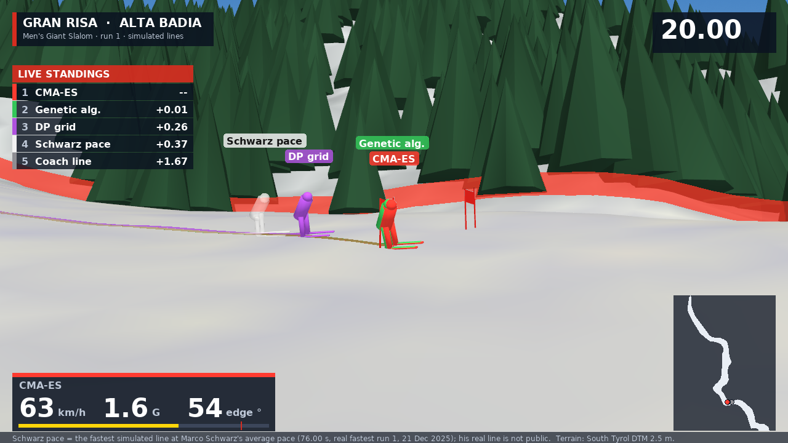

# Ski Racing-Line Optimizer: a World Cup GS Run on the Gran Risa

**Can evolution find a faster line down a real World Cup Giant Slalom than the world's best skiers?**

We simulate a Giant Slalom (GS) race on the **real 3D terrain of the Gran Risa** in Alta Badia, Italy, home of a World Cup GS race since 1985. The slope comes from a 2.5 m government elevation model. The course is a FIS-legal set of 52 gates, matching the 21 December 2025 men's race. A simulated skier runs the course in 3D: the slope's pitch, side-tilt (camber and fall-away), rolls and compressions all change their speed, the G-force they feel and how far they can tilt their skis before their boots touch the snow ("boot-out").

The racing line is what we optimize. Evolutionary algorithms (CMA-ES and a genetic algorithm we wrote ourselves) compete against gradient descent (Adam), a hybrid of the two, and a grid search, all on the same budget. Every candidate line is judged like a real race: the time it takes, weighted by the chance of crashing out or missing a gate.

**Headline result:** CMA-ES finds a line that runs **74.5 s**. The model is calibrated to the real race, where Marco Schwarz's fastest run 1 on 21 Dec 2025 took **76.00 s**.



Evolutionary Computing independent project, DCS 340, Bates College. Kyle Robin and Liam Baron. Who did what, and how we used GenAI: [docs/TEAM.md](docs/TEAM.md).

### How the project is built

1. **Stage 1 — 2D validation (done).** A simplified skier on a flat tilted plane, used to build and test the physics, the FIS course rules, the crash model and every optimizer before moving to real terrain. Results: [docs/reports/final_easy](docs/reports/final_easy/SUMMARY.md), [final_trap](docs/reports/final_trap/SUMMARY.md).
2. **Stage 2 — the Gran Risa in 3D (the project).** Real terrain, the real course length and gate count, and calibration against the real race. Every main result comes from here: [docs/reports/final_gran_risa](docs/reports/final_gran_risa/SUMMARY.md).
3. **Stage 3: the race simulation.** Every optimizer's best line races head to head down the 3D Gran Risa, filmed like a World Cup broadcast. See [Watch the race](#watch-the-race) below.

## Watch the race

[](docs/media/gran_risa_race.mp4)

**[▶ docs/media/gran_risa_race.mp4](docs/media/gran_risa_race.mp4)** (1080p; on GitHub, open the file and click *View raw* to download it).

Each skier is one optimizer's best line from the final runs, replayed on the real terrain. All of them start together, so the gap between two skiers on screen is their time gap. The camera cuts between a chase camera, a side camera on the piste edge, a drone shot and a finish camera. The on-screen graphics show:
- live standings with time gaps;
- the leader's speed, G-force and edge angle, with a red mark at the boot-out limit (75.7°);
- a course map;
- Marco Schwarz's official split times as the clock passes them;
- a results board that ranks the simulated lines against the real top 5 of 21 Dec 2025.

The white "Schwarz pace" ghost is the fastest simulated line, run at Schwarz's average pace (76.00 s). His real line was never published, so the ghost shows his time, not his line. Nothing in the video is re-simulated: it replays the saved telemetry (`telemetry.csv`) of each run.

```bash
pip install -r requirements-video.txt        # PyVista (3D rendering) + ffmpeg (video encoding)
python -m skiopt.analysis.race_video results/gran_risa --out docs/media/gran_risa_race.mp4
python -m skiopt.analysis.race_video results/gran_risa --out frame.png --still 30          # one frame at t = 30 s
python -m skiopt.analysis.race_video results/gran_risa --out chase.mp4 --camera chase --methods cmaes ga adam
```

The original implementation plan is in [docs/PLAN.md](docs/PLAN.md), and the 3D plan is in [docs/ROADMAP_3D.md](docs/ROADMAP_3D.md). These are the official copies: change the plan there, in a commit.

## Setup (Mac)

```bash
python3 -m venv .venv
source .venv/bin/activate
pip install -r requirements-lock.txt   # exact versions of everything, incl. transitive deps
```

`requirements.txt` lists the direct dependencies; `requirements-lock.txt` is a full `pip freeze` of a clean install of it. After changing `requirements.txt`, regenerate the lock file in a fresh venv with `pip install -r requirements.txt && pip freeze > requirements-lock.txt`.

Tested with Python 3.13 and 3.14 (JAX 0.11.2, evosax 0.3.1). Every pinned package supports Python 3.12 or newer.

## Running

```bash
pytest                                                   # run the tests (101 tests, ~4 min; the race-video frame test needs requirements-video.txt)
python -m skiopt.run configs/experiments/smoke.yaml      # pipeline smoke test; add --force to re-run
python -m skiopt.bench                                   # evaluation speed vs. the < 50 ms / 1,000 target
python -m skiopt.analysis.plots --generated 7 --out figures/gen_7.png   # plot a course (or --library easy, --run <dir>)
python -m skiopt.analysis.risk_map --out figures/risk_map.png            # tune configs/risk.yaml
python -m skiopt.run configs/experiments/baseline.yaml                  # day-6 gate: every spline method on the easy course
python -m skiopt.analysis.summarize results/baseline                    # tables + race reports -> results/baseline/SUMMARY.md
python -m skiopt.batch configs/experiments/final_easy.yaml --jobs 4     # many experiments: one job per (method, seed), N at a time
python -m skiopt.analysis.gran_risa_figures results/gran_risa --out figures/gran_risa   # 3D: line on the map, run trace, splits
python -m skiopt.analysis.report_all                                  # every final report -> docs/reports/final_*
python -m skiopt.analysis.sensitivity configs/experiments/gran_risa.yaml physics.mu 0.02 0.04 0.06 --out docs/reports/sensitivity_mu   # re-optimize at each value
```

Results go to `results/<experiment>/<method>/seed_<n>/` (git-ignored): `manifest.json`, `progress.csv`, `champion.npz`, `telemetry.csv`. Finished runs are skipped on re-run. Figures and tables are rebuilt from saved results, never by re-running simulations.

### Code map

| Module | What it does |
| --- | --- |
| `skiopt/types.py` | `SimParams`, `State`, `StepOutput`, `Course`, `Gates`, `Summary` (JAX pytrees) |
| `skiopt/terrain.py` | Terrain protocol + θ(y) pitch profile |
| `skiopt/dynamics.py` | 2D point mass: curvature clip, lateral load a_net, turning bands, speed update |
| `skiopt/rollout.py` | Fixed-length `lax.scan` rollout; padding steps after the finish are masked |
| `skiopt/courses.py` | `CourseSpec`, FIS validator, course generator, `easy` library course, padding to stack courses |
| `skiopt/objectives.py` | `evaluate` / `value_and_grad`; E[score] = P_finish·T + P_DNF·T_DNF; every DNF (missed gate, piste, G_max, v_stop) is a graded DQ in the hard score; softplus penalties + walls in the smooth loss |
| `skiopt/analysis/plots.py` | Course plot: gates, piste, start/finish, line coloured by speed, pitch profile |
| `skiopt/hazard.py`, `configs/risk.yaml` | DNF model: 4 hazard terms + hard limits, each switchable and tunable |
| `skiopt/policies.py` | Open-loop curvature, the spline line, and the apex-and-arc line (main; its default is the coach line). MLP to come |
| `skiopt/optim/` | `adam` (+ restarts), `cmaes`, `cmaes_smooth`, `ga`, `hybrid`, plus `fall_line` / `random_search` baselines; `registry.py` maps names to methods |
| `skiopt/analysis/risk_map.py` | DNF risk of one turn over radius × speed, for tuning `risk.yaml` |
| `skiopt/analysis/race_video.py` | Broadcast-style race video on the 3D Gran Risa: every method's best line head to head, TV graphics, results vs. the real race |
| `skiopt/analysis/summarize.py` | `SUMMARY.md` + `summary.csv` from saved runs: headline table, pairwise tests, race reports, warnings |
| `skiopt/run.py`, `logger.py`, `budget.py`, `config.py` | Runner, result files, rollout-equivalent budget, YAML config |

## Status

| Step | Status |
| --- | --- |
| Setup, plan v2.1 | Done |
| Days 1–8 (2D): simulator, FIS courses, DNF model, optimizers, trap course | Done |
| 2D results, easy course, 3 seeds | Done: [arc line (main)](docs/reports/2d_easy_arc/SUMMARY.md), [spline (contrast)](docs/reports/2d_easy_spline/SUMMARY.md). All methods within 1% on the arc line; CMA-ES reaches it ~28x faster than Adam (10-seed final: ~20x). The spline line costs every method 17-30 s. |
| 3D (docs/ROADMAP_3D.md): Gran Risa terrain pipeline | Done: [terrain figures](docs/reports/gran_risa_terrain) |
| 3D simulator (camber, fall-away, rolls, compressions, edge angle) | Done, tested against analytic cases |
| Gran Risa course set (52 gates / 51 turning, as in the 21 Dec 2025 race, run 1) | Done; 3D carving loss calibrated so the DP-optimal line matches the real 76.00 s |
| DP global baseline ("discretize and search") | Done |
| Final runs: 10 seeds, every method, on the easy course, the trap course and the Gran Risa (220 jobs via `python -m skiopt.batch`) | **Done** (Nov 6, 220/220 clean): [easy](docs/reports/final_easy/SUMMARY.md), [trap](docs/reports/final_trap/SUMMARY.md), [Gran Risa](docs/reports/final_gran_risa/SUMMARY.md). CMA-ES on the hard score is best or tied-best everywhere; on the Gran Risa it runs 74.5 s (real winner 76.00 s) and beats the DP lattice (75.9 s). Write-up: [docs/REPORT.md](docs/REPORT.md) §5–6. |
| Sensitivity: snow friction, 3D carving loss | Done: [μ](docs/reports/sensitivity_mu/SENSITIVITY.md), [k_turn](docs/reports/sensitivity_k_turn/SENSITIVITY.md). About 1.3 s per 0.01 of friction. |
| Ablation: sharp (unbiased) gate penalty for the gradient methods | Sharp penalty done (REPORT.md §6: removes the bias, Adam 1.6–1.9 s faster on the Gran Risa but clips gates by mm–cm); 5 cm margin done: all runs clean, Adam's gap to CMA-ES halves on the Gran Risa and DP → Adam beats DP (75.57 vs 75.94 s); with the margin Adam ties CMA-ES on the trap course (52.07 vs 52.05); with a sharp 3D edge-angle wall too, Adam reaches 74.88 s on the Gran Risa (CMA-ES 74.80) — REPORT.md §6 |
| **Stage 3: race simulation on the 3D Gran Risa** (broadcast cameras, head-to-head ghosts, live telemetry, Schwarz's splits, results vs. the real top 5) | **Done** (Nov 7): [video](docs/media/gran_risa_race.mp4), `skiopt/analysis/race_video.py` |
| Report reframed around the Gran Risa; README and notebook for a non-specialist reader; team roles; GenAI disclosure | To do, target Nov 30 |
| Neural controller | Stretch (cut first, see the roadmap) |
